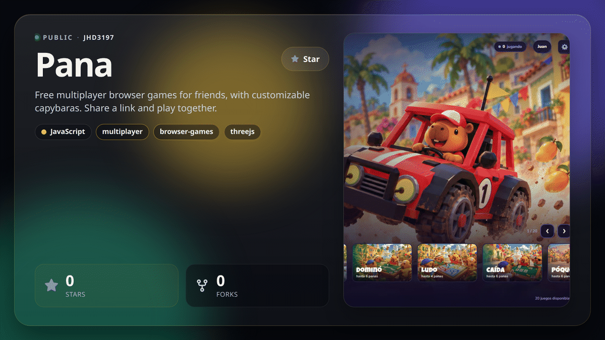
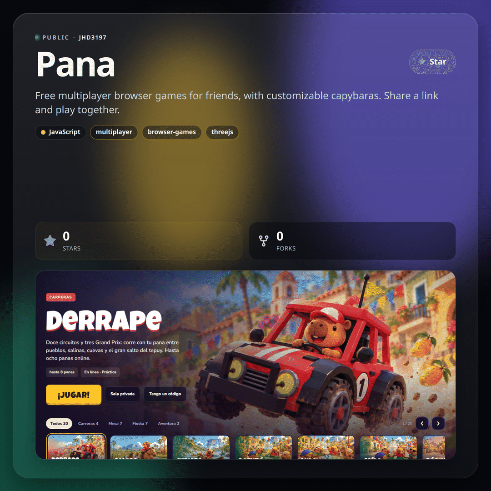
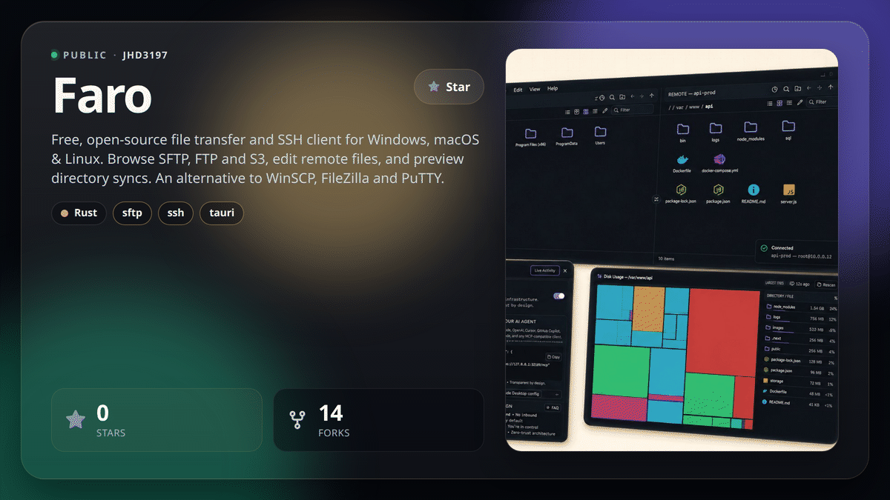
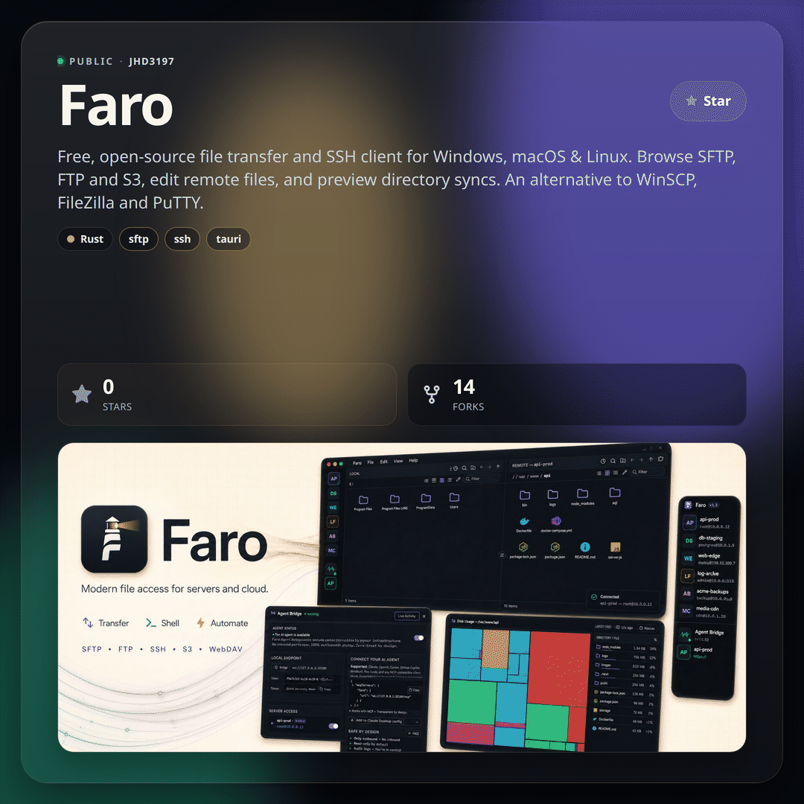
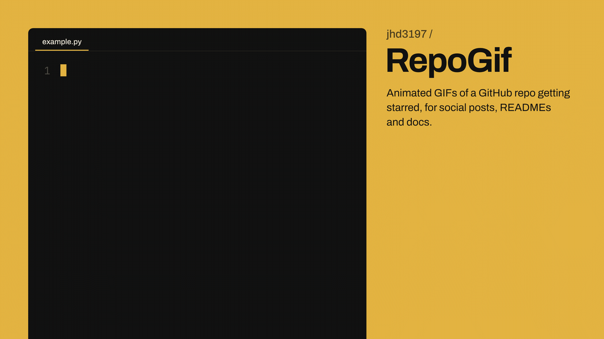
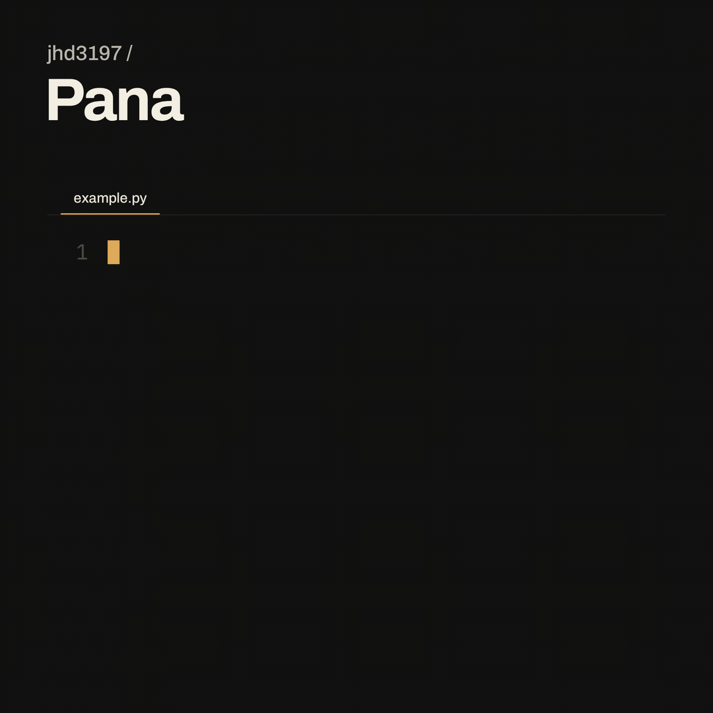

# RepoGif 🎥⭐

Generate beautiful animated GIFs that mimic GitHub repo stars/forks with realistic visuals.  
Perfect for social sharing, repo previews, documentation, or just for fun.

## Features

- 🌈 Gradient backgrounds with authentic GitHub styling
- 🎨 Web-based animation with HTML/CSS/JS for high-quality visuals
- ⚙️ Customizable repository name, star count, and fork count
- 🔍 High-fidelity captures using Puppeteer
<br><br>

> [!TIP]
> Starring this repo helps more developers discover RepoGif 🎥
>
> 
> 
<br>

## Install

```bash
git clone https://github.com/yourname/RepoGif.git
cd RepoGif
pip install -e .
playwright install
```

### Dependencies

- Pillow - Image processing
- imageio - GIF creation
- imageio-ffmpeg - Video encoding support
- numpy - Numerical operations
- playwright - Browser automation

## Usage

### Call from Python:
```python
from repogif.generator import generate_repo_gif

generate_repo_gif(repo_name="RepoGif", stars=250, forks=30, out="output.gif")
```

### Run from CLI (after install):
```bash
repogif
```

### Advanced Options

You can customize various aspects of the generated GIF:

```python
generate_repo_gif(
    repo_name="MyAwesomeProject",
    stars="5.8k",  # Supports string format for larger numbers
    forks=397,
    out="custom_animation.gif"
)
```

## How It Works

RepoGif uses a multi-step process to create high-quality animations:

1. Uses static HTML templates with customizable parameters via URL query strings
2. Uses Playwright to capture two frames (unstarred and starred states)
3. Creates final GIF using PIL with 1-second duration per frame

The template-based approach allows for visually appealing animations with:
- Gradient backgrounds
- Proper GitHub styling and iconography
- Realistic cursor positioning
- Star button interactions with visual feedback

## Customization

The templates are located in `repogif/templates/`, with each template in its own directory:
- Each template has its own template.html file and necessary assets
- Templates can be customized via URL parameters:
  - Repository name
  - Star count
  - Fork count
  - Display dimensions
- You can also create new templates following the existing structure

---

👉 This repo is fully usable right now. Just run:

```bash
python examples/example.py
```

and you'll get a RepoGif output in the examples/ folder 🎥.

## Templates

RepoGif offers a variety of templates to showcase your repository in different styles and formats. Choose the one that best suits your needs.

### Template 1 - Simple Star Animation

A simple 2-frame GIF showing star button animation with authentic GitHub styling.


**Default Dimensions**: Variable based on content

**Variants**:
- 
- 

### Template 2 - Square Badge

A square badge displaying repository statistics with clean, modern design.


**Default Dimensions**: 250x250 pixels

### Template 3 - Horizontal Banner

A wide banner perfect for repository headers or documentation pages.


**Default Dimensions**: 600x120 pixels

### Template 4 - Circular Badge

A circular badge with focused repository statistics in a compact form.


**Default Dimensions**: 250x250 pixels

### Template 5 - Vertical Card

A vertical card layout with gradient background for an elegant presentation.


**Default Dimensions**: 300x400 pixels

### Template 6 - Minimalist Tile

A clean, monochrome design focusing on essential repository information.


**Default Dimensions**: 320x200 pixels

### Template 7 - Animated Badge

An eye-catching badge with pulsing star effect animation.


**Default Dimensions**: 280x280 pixels

### Template 8 - Commit Pattern


**Variants**:
- 
- 

### Template 9 - Contributors


**Variants**:
- 
- 


### Template 10 - Modern Spotlight

A glass card for X posts. It renders at 2x and downscales to the output size, then eases across 30 frames: the star count climbs, the star fills, and the card picks up the accent color. The same frames are written as a GIF and an MP4.

**X sizes**: 1200×675 and 1080×1080. Frames are drawn at 2× and downscaled, so type stays sharp. GIF output is the exact size and stays under 15MB. The 1200×675 MP4 is 1200×676 because H.264 needs an even height.

Optional fields: `description`, `language`, `topics`, `accent`, `owner`, and a `hero` screenshot.

```python
generate_repo_gif(
    repo_name="Pana",
    owner="jhd3197",
    description="Free multiplayer browser games for friends, with customizable capybaras. Share a link and play together.",
    language="JavaScript",
    topics=["multiplayer", "browser-games", "threejs"],
    stars=1,
    forks=0,
    accent="#ffc629",
    hero="examples/assets/pana-hub.jpg",
    hero_focus="94% 42%",
    out="examples/samples/pana-1200x675.gif",
    mp4="examples/samples/pana-1200x675.mp4",
    template="template10",
    width=1200,
    height=675,
)
```

Square posts use the same call with `width=1080` and `height=1080`. `examples/test_template10.py` writes both sizes, as GIF and MP4, for [Pana](https://github.com/jhd3197/Pana) and [Faro](https://github.com/jhd3197/Faro).

#### jhd3197/Pana





#### jhd3197/Faro






### Template 13 - Run it

A usage snippet types itself into a code editor, then the output line appears and the hero image slides out like a print. Good for showing how little code it takes to use a project.

Optional fields: `code` (the snippet to type), `hero`, `accent` (the plate color, default `#e3b341`), `owner`, and `language`. It renders at 2x like template 10, and also writes an MP4 if you pass `mp4=`.

```python
generate_repo_gif(
    repo_name="Pana",
    owner="jhd3197",
    template="template13",
    code='''from repogif import generate_repo_gif

generate_repo_gif(
    repo_name="Pana",
    owner="jhd3197",
    template="template13",
    out="pana.gif",
)''',
    hero="examples/assets/pana-hub.jpg",
    accent="#e3b341",
    out="examples/samples/repogif-run-gold-wide.gif",
    width=1200,
    height=675,
)
```





## Troubleshooting

### Common Issues


#### Blank or Corrupted GIF
This could be due to:
- Frame capture issues - Check for browser compatibility
- Puppeteer configuration - Try running with different arguments
- File path problems - Ensure all paths are correct

## Example Output
When run, this package generates an animated GIF showing a GitHub repository with stars and forks, along with a realistic cursor animation.
